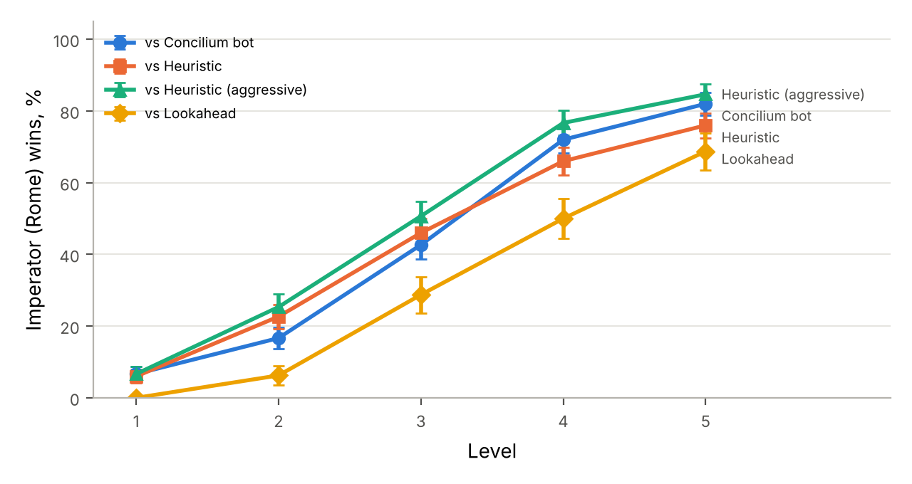
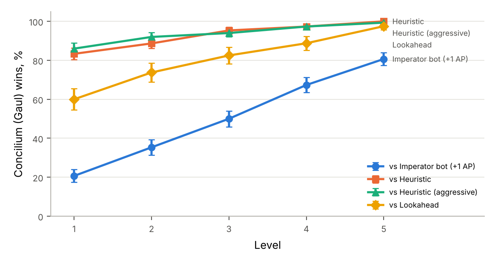

# Caesar: Rome vs. Gaul — Solo Bots: Simulation Report

*Imperator and Concilium, version 1.0. These are model results from computer play, not tabletop results.*

## 1. Summary

* **Both bots play complete games of the 2nd-edition rules.** Each decision comes from a Directive card and a two-card Offer, following the printed rules. The bot never looks at hidden cards. An independent clean-room implementation of the printed rules matched the simulation bot on more than 99% of card and mission choices.
* **The levels form a smooth ladder against every computer opponent.** Against the strongest of them, the Lookahead player:
    * Imperator wins 0% at level 1, 29% at level 3 and 69% at level 5;
    * Concilium wins 60% at level 1, 82% at level 3 and 98% at level 5.
* **Concilium is the stronger bot.** Under the standard rules (its level 4) it wins 67% against Imperator with +1 AP and 89% against the Lookahead player. Rome-side computer players are weaker than skilled humans, so Concilium's levels start with a lower VP target for you: 9 VP at level 1. Level 3 (11 VP) is the recommended start.
* **Imperator at level 3** (+1 AP on every card play) wins 43% of its games against Concilium and about 48% against the Heuristic players.
* **A typical bot-vs-bot game (Imperator at level 3, Concilium under the standard rules) is a Governance race.** Rome earns most of its VP from Governance, plus Caesar's Pass. A game has few battles (about 1.5) and around 9 siege rolls.
* 5,300 games were played for the final study, and many thousands more during development.

## 2. The simulation engine

The engine (`code/engine.py`, `events.py`, `cards.py`, `map.json`) plays complete games of the 2nd-edition rules:

* **Map:** 117 spaces and 275 connections (path, rough, Channel); 26 provinces in 6 regions. Extracted from the Vassal module's map and checked against the printed province values.
* **Turns:** six turns of reinforcements (3 Tribes per turn, Turn-5 Legions, Ambiorix, Vercingetorix) and card play with Reactions and Surprise cards. Each turn ends with Winter: Supply, Isolation, Governance, Winter Camps, Fading Promises and Spring Muster.
* **Cards:** all 55, each played as an Event, a Bonus card or AP.
* **Movement and combat:** Command Ratings and over-command, Interception, Avoid Battle and Back Up, battles with leader and elite rerolls, retreats, and Submission at 3:1.
* **Sieges:** Siege Points, surrender at 3:1 and Strongholds, including Caesar's Pass.
* **Influence:** Place, Convert and Remove, Local Support, the Council Box and the Major Uprising.
* **The edges of the map:** Germania and Britannia with native attacks, and Storms at Sea.
* **Victory:** both automatic victories and the Turn 6 VP total.

## 3. Opponents

Each bot was tested against four computer players of the other side.

| Opponent | How it plays |
|---|---|
| **Bot** | The other paper bot, following its printed rules exactly. In the Imperator rows it is Concilium under the standard rules. In the Concilium rows it is Imperator at its level 3 (+1 AP on every card play), the strongest Roman player available. |
| **Heuristic** | Sees its whole hand and scores every Event and AP use with hand-tuned values. |
| **Heuristic (aggressive)** | The same player with 1.5× weight on attacks and 0.7× on influence. |
| **Lookahead** | For each card, tries the candidate plays on a copy of the game with fresh dice (so it cannot see the future) and keeps the one its position evaluation likes best. |

None of them plays as well as a strong human. Read the tables as a comparison between levels and between opponents, not as a forecast of your own win rate. The Lookahead player is the strongest of them, so its column is the best guide to a skilled opponent.

## 4. How the bots were developed

**Concilium** beat every Roman computer player from its first version. Its rules are short:

* **RAID** where the Legions are not.
* **AMBUSH** only at good odds.
* **AGITATE**.
* **BANK** IMs in the Council Box early.
* **RISE** to spend them.

Most of the tuning went into three things: the RAID weights (Narbonensis first, never next to Caesar), when to BANK and RISE, and the *danger* rule (section 6).

**Imperator** was much harder, because Rome must *earn* 12 VP while Gaul only has to stop it. The first Imperator decks were built around sieges and battles, and they scored about 3 VP a game. The fixes came from four kinds of test:

* **A passive opponent.** Against a Gaul that did nothing, Imperator scored 14–15 VP. So the engine and the scoring were sound, and the weakness was in the decisions.
* **A lookahead hybrid.** One version of Imperator tried every mission on a copy of the game with fresh dice and logged which ones paid. Removing Gallic IMs (RAID) and completing provinces (RULE) were worth far more per AP than sieges. A siege paid only when the Town was about to fall. That finding produced RULE (Control Table lines 0–3), the SWEEP procedure and the strict SIEGE targets.
* **Ablations.** Each mission was switched off in turn, and so were the block and deny lines and the size of the Offer. A change was kept only if it held up on fresh seeds. An Offer of two cards played as well as seeing three cards or the whole hand, so the bot keeps the simpler Offer.
* **Loss analysis.** Legions were dying to Gallic ambushes, about 2.9 per game, mostly in two-Legion Legate armies in Belgica. This produced the *danger* rule and the REGROUP mission.

Ideas that did not help, and were dropped:

* An expedition to Britannia or Germania from Turn 3. The 2 VP rarely made up for Caesar's absence.
* More sieges.
* Looser siege rules for every army. They helped against Concilium but cost VP against the Heuristic and Lookahead players. Only Caesar's army was given the looser rule (section 6).
* Blocking provinces before their Tribe arrives.
* A danger ratio other than 1.5 for Imperator. Ratios of 1.0, 1.25 and 2.0 were all tried.

## 5. Independent checks

Two separate agents checked the work. Neither had written the code.

* **Engine audit.** Compared the engine with the 2023 living rules and reported 23 findings. The important ones were fixed: Submission is now checked before Avoid Battle, legion attrition was corrected, and Roman supply sources now trace correctly. One item was kept on purpose (Fading Promises), and one simplification remains (Sorties). See `audit/ENGINE_AUDIT_RESPONSE.md`.
* **Clean-room test.** Wrote a second implementation of both bots from the printed rules only, then compared it with the simulation bot decision by decision. Before fixes, the two agreed on:
    * 99.8% of card choices;
    * 99.4% of mission choices;
    * 90–96% of full AP decisions (mission, army and target).

    Every gap it found was closed, either by clarifying the text or by fixing the code. One of the code fixes was an engine bug in how losses were applied, which affected both sides. See `audit/CLEANROOM_RESPONSE.md`.

## 6. The final changes and what they were worth

These changes were made after the clean-room fixes. Each row compares the same seeds with and without the change. The Imperator rows are at level 3.

**Imperator** at level 3. Seeds 9000+: 200 games each against the Bot and Heuristic players, 100 against the Lookahead player. The Bot here is the Concilium of that time, before its own danger rule was added. Each cell gives Imperator's win rate and its mean VP.

| Version | vs Bot | vs Heuristic | vs Lookahead | Legions lost per game |
|---|---|---|---|---|
| Before | 38.5% (10.7 VP) | 36.0% (10.2 VP) | 17% (8.5 VP) | 2.3 |
| + REGROUP | 40.0% (10.4 VP) | 42.5% (10.7 VP) | 17% (9.1 VP) | 1.5 |
| + REGROUP + danger limit on SWEEP (adopted) | 43.0% (10.8 VP) | 46.0% (10.9 VP) | 18% (9.0 VP) | 1.3 |

**Concilium's danger ratio**, the Roman BS (as a multiple of the Gallic BS) at which a space counts as dangerous for its SWEEPs. Seeds 9500+: 160 games against Imperator with +1 AP and against the Heuristic player, 80 against the Lookahead player. Each cell gives Concilium's win rate, then the mean Roman VP (lower is better for Gaul).

| Danger ratio | vs Imperator (+1 AP) | vs Heuristic | vs Lookahead |
|---|---|---|---|
| none | 53% (11.1) | 95% (6.0) | 75% (8.6) |
| 2× | 68% (10.2) | 97% (5.5) | 85% (7.6) |
| 1.5× | 71% (9.8) | 96% (5.5) | 94% (7.3) |
| **1× (adopted)** | 75% (9.5) | 96% (4.6) | 98% (6.5) |
| 0.5× | 78% (9.4) | 96% (4.4) | 94% (6.9) |

Below 1× the gains level off, and 1× ("a Roman army could reach it with at least equal strength") is the simplest rule to apply at the table.

**Two last Imperator changes**, tested against the final Concilium. Each cell is the change in Imperator's mean VP at level 3 on the same seeds, one figure per seed set: 200 games against Concilium and against the Heuristic player, and 120 against the Lookahead player.

| Change | vs Concilium | vs Heuristic | vs Lookahead |
|---|---|---|---|
| Control Table: **lagging region first** (Celtica or Belgica, whichever Rome is not winning) | +0.35, +0.42 | +0.32, +0.52 | +0.84, +0.08 |
| SIEGE: **Caesar's army at 2:1** may siege any Town (before: only a Town with a Siege Point already on it) | +0.61, +0.24 | −0.35, −0.21 | +0.19, +0.30 |

Both were adopted. The second costs a little against the Heuristic player but gains against the two stronger opponents.


## 7. Final study

**Method.**

* Every level of each bot played every opponent: 150 games against the Bot and Heuristic players and 80 against the Lookahead player, 5,300 games in all.
* The study used seed ranges 100000+ (Imperator) and 200000+ (Concilium), which were never used during development.
* All cards used the assumed 2nd-edition AP values.
* The cells below give the bot's win rate and the mean Roman VP. With 150 games the margin of error is about ±7 points; with 80 games, about ±9.



*Error bars show one standard error.*



### Imperator (bot plays Rome; cells = Imperator win rate, mean Roman VP)

| Level | Bot | Heuristic | Heuristic (aggressive) | Lookahead |
|---|---|---|---|---|
| 1 | 7% (7.2 VP) | 6% (6.5 VP) | 7% (6.9 VP) | 0% (3.6 VP) |
| 2 | 17% (9.0 VP) | 23% (9.2 VP) | 25% (9.4 VP) | 6% (6.7 VP) |
| 3 | 43% (10.7 VP) | 46% (10.8 VP) | 51% (11.4 VP) | 29% (9.6 VP) |
| 4 | 72% (10.7 VP) | 66% (10.8 VP) | 77% (11.4 VP) | 50% (9.6 VP) |
| 5 | 82% (10.7 VP) | 76% (10.8 VP) | 85% (11.4 VP) | 69% (9.6 VP) |

### Concilium (bot plays Gaul; cells = Concilium win rate, mean Roman VP)

| Level | Bot | Heuristic | Heuristic (aggressive) | Lookahead |
|---|---|---|---|---|
| 1 | 21% (10.3 VP) | 83% (4.7 VP) | 86% (4.5 VP) | 60% (7.4 VP) |
| 2 | 35% (10.3 VP) | 89% (4.7 VP) | 92% (4.5 VP) | 74% (7.4 VP) |
| 3 | 50% (10.3 VP) | 95% (4.7 VP) | 94% (4.5 VP) | 82% (7.4 VP) |
| 4 | 67% (10.3 VP) | 97% (4.7 VP) | 97% (4.5 VP) | 89% (7.4 VP) |
| 5 | 81% (8.9 VP) | 100% (2.1 VP) | 99% (1.5 VP) | 98% (4.2 VP) |

Imperator levels 3–5 differ only in the VP Rome needs, so they play the same games and show the same mean VP. The same is true of Concilium levels 1–4.


## 8. How the games are decided

These figures come from 300 games of Imperator (level 3) against Concilium (standard rules), on seeds from 300000 up. Rome won 126 of them (42%), with a mean of 10.6 VP.

**Where Rome's VP come from (per game):**

| Source | VP |
|---|---|
| Governance (six winters) | 9.6 |
| Caesar's Pass | 0.83 |
| Germania and Britannia | 0.07 |
| Eliminated Tribes (÷4) | about 0.9 (3.6 Tribes) |
| Eliminated Legions | −0.49 |

**Mean Governance by winter** (9–10 Governance gives 2 VP, 7–8 gives 1):

| Turn | 1 | 2 | 3 | 4 | 5 | 6 |
|---|---|---|---|---|---|---|
| Mean Governance | 9.2 | 9.3 | 9.3 | 9.1 | 8.9 | 8.7 |

65% of Rome's winters reach 9–10 Governance. The rest fall to 7–8, nearly always because Belgica is tied or lost. Turn 6 is the hardest winter, because Concilium saves its Submitted Tribes and Council IMs for a late Major Uprising.

**Battles are rare.** A game averages 1.5 battles and 9.2 siege rolls, because neither bot gives the other good odds. REGROUP keeps Imperator's Legate armies out of reach, and Concilium never sweeps into danger. A human who takes risks will see more fighting.

**Close games.** 36% of games end on 11 or 12 VP, a point either side of the target, so every Governance point matters.

**VP distribution (VP: games):** 3: 2, 5: 6, 6: 9, 7: 13, 8: 26, 9: 37, 10: 39, 11: 42, 12: 66, 13: 38, 14: 19, 15: 3.

## 9. Limitations

* **These are computer opponents.** A strong human will beat the Heuristic and Lookahead players. Expect your results against Imperator to be better than theirs, and against Concilium perhaps much better.
* **The 2nd-edition card values are assumed.** The 2nd edition gives five cards 3 AP, three cards 1 AP and makes the rest 2 AP. Which cards carry which value is assumed. The card texts are 1st edition, and the 2nd edition changes some text.
* **Simplifications in the engine.** Sorties and a few rare rules are simplified (see the audit response). They change the numbers a little but not the bots' rules.
* **Tuning targets.** Imperator was tuned against the Concilium, Heuristic and Lookahead players, so it may be tuned to their habits. Concilium was tuned against Imperator and the Heuristic player.

## 10. Reproducing the results

```
cd code
python3 study.py                      # full study, about an hour on 2 cores
python3 sample_game.py 45 out.md      # the sample game
```

The raw results are in `results/study_final.json`, and the bot-vs-bot breakdown is in `results/decide.json`.
